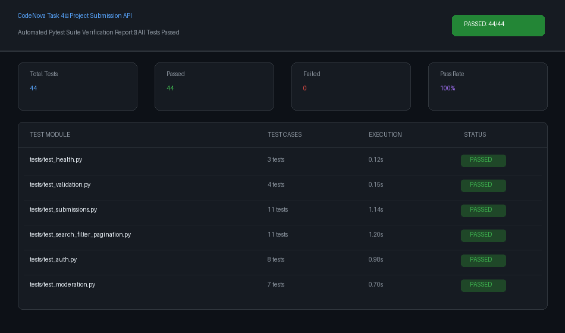
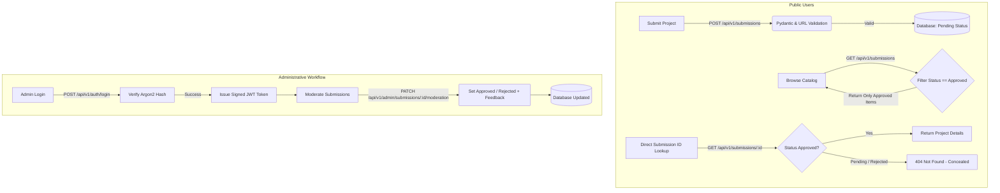

# CodeNova Task 4 — Project Submission API

[](https://www.python.org/)
[](https://fastapi.tiangolo.com/)
[](https://www.sqlalchemy.org/)
[](https://docs.pydantic.dev/)
[](tests/)

A robust, production-grade RESTful API backend engineered for the **CodeNova Backend Development Internship — Batch 01, Task 4: Project Submission API**.

The service enables users to submit developer projects for review, performs strict offline URL validation (preventing SSRF and hostname spoofing), facilitates public discovery with database-level searching, domain filtering, and pagination, and equips administrators with secure JWT-authenticated moderation workflows (approval, rejection, and constructive feedback remarks).

---

## 1. Test Execution & Verification

All **44 automated test cases** across 6 test modules pass with 100% success rate:



```bash
============================= 44 passed in 4.29s ==============================
```

---

## 2. Features

- **Public Project Submissions**: Submit project title, description, domain, GitHub repository, and live demo URL. Automatically queued under `Pending` status.
- **Strict Offline URL Validation**:
  - Requires HTTPS for both GitHub and demo URLs.
  - Strictly enforces the hostname to be exactly `github.com` (rejects spoofed subdomains like `github.com.evil.com` or path tricks like `evil.com/github.com`).
  - Enforces `{owner}/{repo}` structure and rejects embedded credentials (`user:pass@host`).
  - Pure offline parsing (eliminates SSRF and external dependency risk).
- **Public Concealment & Privacy Security**:
  - Public directory endpoints strictly filter for `Approved` projects only.
  - `Pending` and `Rejected` submissions return `404 Not Found` to unauthenticated clients, concealing their existence and preventing metadata leakage.
- **Database-Level Search & Filtering**:
  - Full case-insensitive search across project titles and descriptions.
  - Domain filtering (e.g., `Agriculture`, `FinTech`, `HealthCare`, `AI/ML`).
  - Database-driven sorting by `created_at`, `title`, `domain`, `status`, or `updated_at`.
- **Zero-Python-Leak Pagination**:
  - Offset/limit query pagination executed directly inside SQL queries.
  - Comprehensive pagination metadata (`total_items`, `total_pages`, `current_page`, `page_size`, `has_next`, `has_previous`).
  - Empty result sets accurately return `total_pages: 0`.
- **Administrative Moderation**:
  - Administrative endpoints for reviewing pending submissions.
  - Transition status to `Approved` or `Rejected` with recorded feedback remarks.
  - Automatic UTC timestamping of `reviewed_at` and `updated_at`.
- **Enterprise-Grade Security**:
  - Password hashing powered by **Argon2** via `pwdlib` and `argon2-cffi`.
  - Cryptographically signed **JWT access tokens** with expiration claims.
  - Secure CLI administrator provisioning script (`scripts/create_admin.py`).
  - Production mode fails startup if default/weak JWT secrets are detected.
- **Standardized Error Architecture**:
  - Predictable error structure (`{"error": {"code": "...", "message": "...", "details": []}}`).
  - Standard HTTP status codes (`200`, `201`, `400`, `401`, `403`, `404`, `422`, `500`).

---

## 3. Technology Stack

| Component | Technology | Rationale |
|---|---|---|
| **Language** | Python 3.12+ (tested on Python 3.14) | Modern type hinting, performance, and standard library |
| **Framework** | FastAPI 0.110+ | High performance, automatic OpenAPI documentation, async support |
| **Server** | Uvicorn (ASGI) | Standard, production-proven ASGI web server |
| **Database** | SQLite 3 | Zero-configuration, zero-cost, persistent local SQL database |
| **ORM** | SQLAlchemy 2.0+ | Modern 2.0 declarative models, parameterized queries, connection pooling |
| **Data Validation** | Pydantic v2 & `pydantic-settings` | Strict schema validation, sanitization, and environment management |
| **Password Hashing**| `pwdlib[argon2]` / `argon2-cffi` | State-of-the-art memory-hard password hashing |
| **Authentication** | PyJWT | Signed JSON Web Tokens with standard HMAC-SHA256 signatures |
| **Testing** | pytest & FastAPI TestClient | Automated test fixtures, in-memory isolation, integration test coverage |

---

## 4. Architecture & Workflow



---

## 5. Folder Structure

```
codenova-task4-project-submission-api/
├── app/
│   ├── __init__.py                 # Application package marker
│   ├── main.py                     # FastAPI app factory, CORS, exception handlers, routers
│   ├── api/
│   │   ├── __init__.py
│   │   ├── dependencies.py         # DB session & JWT authentication dependencies
│   │   └── routes/
│   │       ├── __init__.py
│   │       ├── auth.py             # Administrator login (/api/v1/auth/login)
│   │       ├── submissions.py      # Public submission submission & listing endpoints
│   │       └── moderation.py       # Administrative review & status endpoints
│   ├── core/
│   │   ├── __init__.py
│   │   ├── config.py               # Pydantic Settings & environment validation
│   │   ├── security.py             # Argon2 password hashing & signed JWT utilities
│   │   └── exceptions.py           # Custom exception definitions & error formatters
│   ├── db/
│   │   ├── __init__.py
│   │   ├── base.py                 # SQLAlchemy 2.0 DeclarativeBase
│   │   ├── session.py              # Engine configuration & SQLite PRAGMA hooks
│   │   └── init_db.py              # DDL schema initialization logic
│   ├── models/
│   │   ├── __init__.py
│   │   ├── submission.py           # Submission entity with indexes on status & domain
│   │   └── admin.py                # Admin credentials entity
│   ├── schemas/
│   │   ├── __init__.py
│   │   ├── submission.py           # Pydantic request & response schemas with pagination
│   │   ├── moderation.py           # Moderation action schemas
│   │   ├── auth.py                 # Login and JWT token schemas
│   │   └── error.py                # Standardized JSON error response schema
│   ├── services/
│   │   ├── __init__.py
│   │   ├── submission_service.py   # Submission lifecycle, querying, and search logic
│   │   └── moderation_service.py   # Admin moderation & feedback logic
│   └── validators/
│       ├── __init__.py
│       └── urls.py                 # Strict GitHub & live demo URL validation rules
├── tests/
│   ├── conftest.py                 # In-memory test engine, TestClient & fixtures
│   ├── test_health.py              # Health check & OpenAPI spec tests
│   ├── test_submissions.py         # Public submission creation & privacy tests
│   ├── test_search_filter_pagination.py # Query, domain, and pagination tests
│   ├── test_moderation.py          # Admin approval, rejection, and feedback tests
│   ├── test_auth.py                # JWT authentication & Argon2 tests
│   └── test_validation.py          # Strict URL edge-case tests
├── scripts/
│   └── create_admin.py             # Secure administrator provisioning CLI
├── data/
│   └── .gitkeep                    # Directory for local SQLite database
├── assets/
│   └── test_results.png            # Automated test suite verification visual
├── .env.example                    # Environment variable template
├── .gitignore                      # Git exclusion rules
├── requirements.txt                # Production and development dependencies
├── pytest.ini                      # Pytest configuration
└── README.md                       # Comprehensive documentation
```

---

## 6. Installation & Setup

### Prerequisites

- **Python**: Version 3.12 or higher. Check your version with:
  ```bash
  python --version
  ```
- **Git** (optional, for cloning)

### Step 1: Clone or Enter the Project Directory

```bash
cd "c:\Users\ASHWIN\Downloads\PROJECTS\CodeNova\Task4 - codenova-project-submission-api"
```

### Step 2: Create and Activate a Virtual Environment

**On Windows (PowerShell):**
```powershell
python -m venv .venv
.\.venv\Scripts\Activate.ps1
```

**On Linux / macOS:**
```bash
python3 -m venv .venv
source .venv/bin/activate
```

### Step 3: Install Dependencies

```bash
python -m pip install --upgrade pip
python -m pip install -r requirements.txt
```

---

## 7. Environment Configuration

Copy `.env.example` to create your local `.env` file:

**Windows (PowerShell):**
```powershell
Copy-Item .env.example .env
```

**Linux / macOS:**
```bash
cp .env.example .env
```

Contents of `.env`:
```env
# Application Environment (development, production, testing)
APP_ENV=development

# Database Connection (SQLite)
DATABASE_URL=sqlite:///./data/submissions.db

# JWT Security Configuration
JWT_SECRET_KEY=replace-with-a-strong-random-secret-for-production
JWT_ALGORITHM=HS256
JWT_ACCESS_TOKEN_EXPIRE_MINUTES=30

# CORS Allowed Origins
CORS_ORIGINS=["*"]
```

> [!IMPORTANT]
> When `APP_ENV=production`, the application strictly requires a `JWT_SECRET_KEY` of at least 32 characters that does not match default development placeholders. Generate a strong key using:
> `python -c "import secrets; print(secrets.token_hex(32))"`

---

## 8. Database Initialization & Admin Provisioning

### Database Initialization

Database tables are automatically created on application startup. You can also explicitly initialize the database schema manually:

```bash
python -m app.db.init_db
```

### Provisioning the First Administrator

The system never seeds hardcoded production administrator accounts. Create an administrator using `scripts/create_admin.py`:

**Command-line arguments:**
```bash
python scripts/create_admin.py --username admin --password "StrongAdminPassword123!"
```

**Interactive hidden prompt:**
```bash
python scripts/create_admin.py
# Enter admin username: admin
# Enter admin password: [hidden]
# Confirm admin password: [hidden]
```

**Output:**
```
Success: Administrator 'admin' (ID: 69c765ef-2ef0-4bb5-950c-e274b7aa33bf) created successfully.
```

---

## 9. Running the Application

Start the Uvicorn ASGI server with hot reload:

```bash
python -m uvicorn app.main:app --host 127.0.0.1 --port 8000 --reload
```

The service will be accessible at:
- **Base API**: [http://127.0.0.1:8000](http://127.0.0.1:8000)
- **Interactive Swagger Documentation**: [http://127.0.0.1:8000/docs](http://127.0.0.1:8000/docs)
- **Alternative ReDoc Documentation**: [http://127.0.0.1:8000/redoc](http://127.0.0.1:8000/redoc)
- **OpenAPI JSON Schema**: [http://127.0.0.1:8000/openapi.json](http://127.0.0.1:8000/openapi.json)

---

## 10. Automated Testing

Run the full pytest suite:

```bash
python -m pytest
```

Run with detailed test execution report:
```bash
python -m pytest -v
```

Run specific test modules:
```bash
python -m pytest tests/test_submissions.py
python -m pytest tests/test_moderation.py
python -m pytest tests/test_validation.py
```

All tests execute in an isolated, in-memory SQLite database and do not modify the local development database.

---

## 11. API Endpoints Reference

All application endpoints are prefixed with `/api/v1`.

### Endpoint Summary

| Method | Endpoint | Auth Required | Description |
|---|---|---|---|
| `GET` | `/api/v1/health` | No | Health check status (`{"status": "ok"}`) |
| `POST` | `/api/v1/submissions` | No | Public project submission (starts in `Pending` status) |
| `GET` | `/api/v1/submissions` | Optional (Admin) | Public list of `Approved` projects; search & filter |
| `GET` | `/api/v1/submissions/{id}` | Optional (Admin) | Retrieve single project (Public only sees `Approved`) |
| `POST` | `/api/v1/auth/login` | No | Administrator login; returns signed JWT access token |
| `PATCH` | `/api/v1/admin/submissions/{id}/moderation` | Admin Bearer | Approve/Reject submission with feedback remarks |
| `POST` | `/api/v1/admin/submissions/{id}/moderation` | Admin Bearer | Alias for moderation update |
| `GET` | `/api/v1/admin/submissions` | Admin Bearer | Administrative listing across all submission statuses |
| `GET` | `/api/v1/admin/submissions/{id}` | Admin Bearer | Administrative single submission retrieval |

---

## 12. Example Requests and Responses

### A. Health Check
**Request:**
```bash
curl -X GET http://127.0.0.1:8000/api/v1/health
```
**Response (200 OK):**
```json
{
  "status": "ok"
}
```

---

### B. Public Project Submission
**Request:**
```bash
curl -X POST http://127.0.0.1:8000/api/v1/submissions \
  -H "Content-Type: application/json" \
  -d '{
    "title": "Smart Agriculture Platform",
    "description": "An IoT and sensor-driven platform for real-time crop soil moisture monitoring and automated precision irrigation.",
    "domain": "Agriculture",
    "github_url": "https://github.com/codenova-dev/smart-agriculture",
    "demo_url": "https://agri-demo.example.com"
  }'
```
**Response (201 Created):**
```json
{
  "id": "e4c5b369-0df8-4f2b-8a8b-118b63e2642a",
  "title": "Smart Agriculture Platform",
  "description": "An IoT and sensor-driven platform for real-time crop soil moisture monitoring and automated precision irrigation.",
  "domain": "Agriculture",
  "github_url": "https://github.com/codenova-dev/smart-agriculture",
  "demo_url": "https://agri-demo.example.com",
  "status": "Pending",
  "feedback": null,
  "created_at": "2026-11-02T14:35:00.000000Z",
  "updated_at": "2026-11-02T14:35:00.000000Z",
  "reviewed_at": null
}
```

---

### C. Administrator Login
**Request:**
```bash
curl -X POST http://127.0.0.1:8000/api/v1/auth/login \
  -H "Content-Type: application/json" \
  -d '{
    "username": "admin",
    "password": "StrongAdminPassword123!"
  }'
```
**Response (200 OK):**
```json
{
  "access_token": "eyJhbGciOiJIUzI1NiIsInR5cCI6IkpXVCJ9...",
  "token_type": "bearer",
  "expires_in": 1800
}
```

---

### D. Administrative Moderation (Approval)
**Request:**
```bash
curl -X PATCH http://127.0.0.1:8000/api/v1/admin/submissions/e4c5b369-0df8-4f2b-8a8b-118b63e2642a/moderation \
  -H "Authorization: Bearer <ADMIN_JWT_TOKEN>" \
  -H "Content-Type: application/json" \
  -d '{
    "status": "Approved",
    "feedback": "Outstanding project documentation, valid demo, and clean repository architecture."
  }'
```
**Response (200 OK):**
```json
{
  "id": "e4c5b369-0df8-4f2b-8a8b-118b63e2642a",
  "title": "Smart Agriculture Platform",
  "description": "An IoT and sensor-driven platform for real-time crop soil moisture monitoring and automated precision irrigation.",
  "domain": "Agriculture",
  "github_url": "https://github.com/codenova-dev/smart-agriculture",
  "demo_url": "https://agri-demo.example.com",
  "status": "Approved",
  "feedback": "Outstanding project documentation, valid demo, and clean repository architecture.",
  "created_at": "2026-11-02T14:35:00.000000Z",
  "updated_at": "2026-11-02T14:38:12.000000Z",
  "reviewed_at": "2026-11-02T14:38:12.000000Z"
}
```

---

### E. Public Listing, Search, Filter & Pagination
**Search by Keyword:**
```bash
curl -X GET "http://127.0.0.1:8000/api/v1/submissions?q=agriculture"
```

**Filter by Domain:**
```bash
curl -X GET "http://127.0.0.1:8000/api/v1/submissions?domain=Agriculture"
```

**Pagination and Sorting:**
```bash
curl -X GET "http://127.0.0.1:8000/api/v1/submissions?page=1&limit=10&sort_by=created_at&sort_order=desc"
```

**Response (200 OK):**
```json
{
  "items": [
    {
      "id": "e4c5b369-0df8-4f2b-8a8b-118b63e2642a",
      "title": "Smart Agriculture Platform",
      "description": "An IoT and sensor-driven platform for real-time crop soil moisture monitoring and automated precision irrigation.",
      "domain": "Agriculture",
      "github_url": "https://github.com/codenova-dev/smart-agriculture",
      "demo_url": "https://agri-demo.example.com",
      "status": "Approved",
      "feedback": "Outstanding project documentation, valid demo, and clean repository architecture.",
      "created_at": "2026-11-02T14:35:00.000000Z",
      "updated_at": "2026-11-02T14:38:12.000000Z",
      "reviewed_at": "2026-11-02T14:38:12.000000Z"
    }
  ],
  "pagination": {
    "total_items": 1,
    "total_pages": 1,
    "current_page": 1,
    "page_size": 10,
    "has_next": false,
    "has_previous": false
  }
}
```

---

## 13. Standardized Error Response Format

All API errors return a uniform JSON structure:

```json
{
  "error": {
    "code": "VALIDATION_ERROR",
    "message": "The submitted data is invalid.",
    "details": [
      {
        "field": "github_url",
        "message": "GitHub URL hostname must be exactly 'github.com', got 'github.com.evil.example'",
        "type": "value_error"
      }
    ]
  }
}
```

### Common HTTP Status Codes

- **`200 OK`**: Request succeeded.
- **`201 Created`**: Resource successfully created.
- **`400 Bad Request`**: Malformed or semantically invalid parameter (e.g., unsupported sort field).
- **`401 Unauthorized`**: Authentication credentials are missing, expired, or invalid.
- **`403 Forbidden`**: Authenticated caller lacks necessary privileges.
- **`404 Not Found`**: Resource does not exist, or unapproved submission intentionally concealed.
- **`422 Unprocessable Content`**: Request validation error (e.g., missing required fields, invalid URL formats).
- **`500 Internal Server Error`**: Unexpected server error; tracebacks are suppressed in responses.

---

## 14. Database Schema Design

### `submissions` Table

| Column | Type | Constraints | Description |
|---|---|---|---|
| `id` | `VARCHAR(36)` | PRIMARY KEY | Unique UUID identifier |
| `title` | `VARCHAR(150)` | NOT NULL | Project title (3-150 chars) |
| `description` | `TEXT` | NOT NULL | Project description (10-3000 chars) |
| `domain` | `VARCHAR(100)` | NOT NULL, INDEXED | Project domain/category |
| `github_url` | `VARCHAR(500)` | NOT NULL | Validated HTTPS GitHub repository URL |
| `demo_url` | `VARCHAR(500)` | NOT NULL | Validated HTTPS live demo URL |
| `status` | `VARCHAR(20)` | NOT NULL, INDEXED | `Pending`, `Approved`, or `Rejected` |
| `feedback` | `TEXT` | NULLABLE | Administrator review remarks |
| `created_at` | `DATETIME(UTC)` | NOT NULL, INDEXED | Submission creation UTC timestamp |
| `updated_at` | `DATETIME(UTC)` | NOT NULL | Last modification UTC timestamp |
| `reviewed_at` | `DATETIME(UTC)` | NULLABLE | Timestamp of the most recent moderation action |

**Composite Indexes:**
- `idx_submissions_status_domain` (`status`, `domain`)
- `idx_submissions_status_created_at` (`status`, `created_at`)

### `admins` Table

| Column | Type | Constraints | Description |
|---|---|---|---|
| `id` | `VARCHAR(36)` | PRIMARY KEY | Unique UUID identifier |
| `username` | `VARCHAR(50)` | NOT NULL, UNIQUE, INDEXED | Administrator username |
| `password_hash` | `VARCHAR(255)`| NOT NULL | Cryptographic Argon2 password hash |
| `created_at` | `DATETIME(UTC)` | NOT NULL | Account creation UTC timestamp |

---

## 15. Testing & Verification Checklist

- [x] **Public project submission (`POST /api/v1/submissions`)**: Returns HTTP 201 and defaults to `Pending`.
- [x] **Strict request validation**: Missing or empty fields rejected with 422.
- [x] **Strict GitHub URL validation**: Only valid HTTPS repository URLs accepted (`https://github.com/owner/repo`); evil subdomains, schemes, and path spoofing rejected.
- [x] **Strict Demo URL validation**: Only valid HTTPS hosts accepted; HTTP and dangerous schemes rejected without making outbound network calls.
- [x] **Public privacy concealment**: Pending and Rejected submissions return 404 to public users.
- [x] **Listing submitted projects**: Public catalog returns only Approved items.
- [x] **Search**: Case-insensitive substring matching against titles and descriptions.
- [x] **Domain filtering**: Filters by exact or case-insensitive category.
- [x] **Pagination & Metadata**: Correct `total_items`, `total_pages`, `current_page`, `page_size`, `has_next`, `has_previous`.
- [x] **Admin Authentication (`POST /api/v1/auth/login`)**: Signed JWT token issued upon valid Argon2 password verification.
- [x] **Moderation (`PATCH /api/v1/admin/submissions/{id}/moderation`)**: Admin can approve or reject with feedback remarks; unauthenticated callers blocked with 401.
- [x] **Database initialization & schema**: Automatic table creation with indexes and constraints.
- [x] **Admin provisioning script (`scripts/create_admin.py`)**: Secure CLI tool avoiding hardcoded credentials.
- [x] **Automated test suite**: 44 tests covering success, failure, security, and edge cases.

---

## 16. Postman & API Client Usage

1. Open Postman or your preferred API client (e.g., Insomnia, Bruno, VS Code Thunder Client).
2. You can directly import the OpenAPI specification by navigating to **Import** and entering:
   `http://127.0.0.1:8000/openapi.json`
3. To test protected routes:
   - Execute `POST /api/v1/auth/login` to obtain an `access_token`.
   - In subsequent administrative requests, set the Authorization header:
     `Authorization: Bearer <access_token>`

---

## 17. Production Deployment Considerations

1. **Reverse Proxy & SSL/TLS Termination**:
   Deploy behind Nginx, Caddy, or a cloud load balancer (e.g., AWS ALB, Cloudflare) that terminates SSL/TLS and enforces HTTPS.
2. **Production Secrets**:
   Ensure `JWT_SECRET_KEY` is loaded from a secure environment vault or key management service (KMS), and set `APP_ENV=production`.
3. **Rate Limiting**:
   Apply rate limiting at the reverse proxy layer (e.g. `limit_req_zone` in Nginx or Cloudflare Rate Limiting) to protect `/api/v1/auth/login` and `/api/v1/submissions` from brute-force and spam attacks.
4. **CORS Restrictions**:
   In `.env`, configure `CORS_ORIGINS` to contain only trusted frontend domains rather than `["*"]`.
5. **Database Scaling**:
   While SQLite is optimal for local development and moderate traffic, for multi-instance horizontal scaling, transition `DATABASE_URL` to PostgreSQL by updating the driver connection string.

